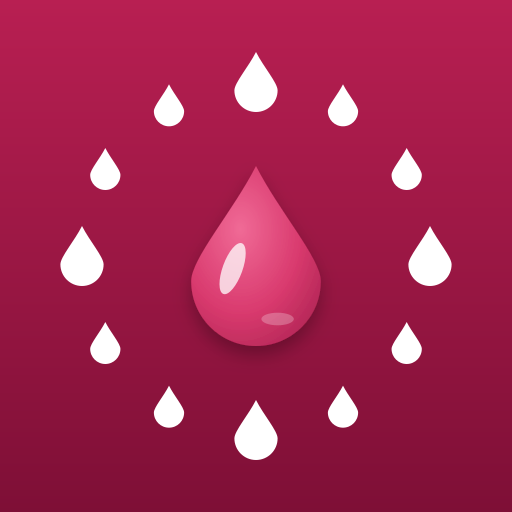

# Червоні дні · Red Days

Приватний щоденник місячних для нерегулярного циклу й СПКЯ (PCOS).
**Два дотики на місяць — і весь рік як на долоні.**

A private period diary for irregular cycles and PCOS.
**Two taps a month — your whole year at a glance.**

## Що вміє / Features

- Позначити початок і кінець місячних — цього достатньо; симптоми, настрій і сон — за бажанням.
- Річне кільце: кожен цикл — дуга, колір — тривалість відносно орієнтира 21–35 днів (міжнародна настанова з СПКЯ 2023).
- Терези «до / після»: як змінилися цикл і симптоми після початку лікування.
- Одна сторінка PDF для лікаря — лише факти.
- Мови: українська, English, polski, español, Deutsch.

## Приватність / Privacy

Усі дані лишаються на телефоні: без акаунта, реклами й аналітики, хмарне копіювання вимкнене.
All data stays on the phone: no account, no ads, no analytics, cloud backup disabled.

- Політика конфіденційності / Privacy policy: https://korolserhii.github.io/red-days/privacy.html

## Важливо / Important

«Червоні дні» не є медичним виробом і не діагностує, не лікує, не виліковує та не запобігає жодній хворобі; не є засобом контрацепції. Для дорослих (18+).
Red Days is not a medical device and does not diagnose, treat, cure or prevent any disease; it is not a method of contraception. For adults (18+).

## Контакт / Contact

Korol Serhii — korolserhii.dev@gmail.com
